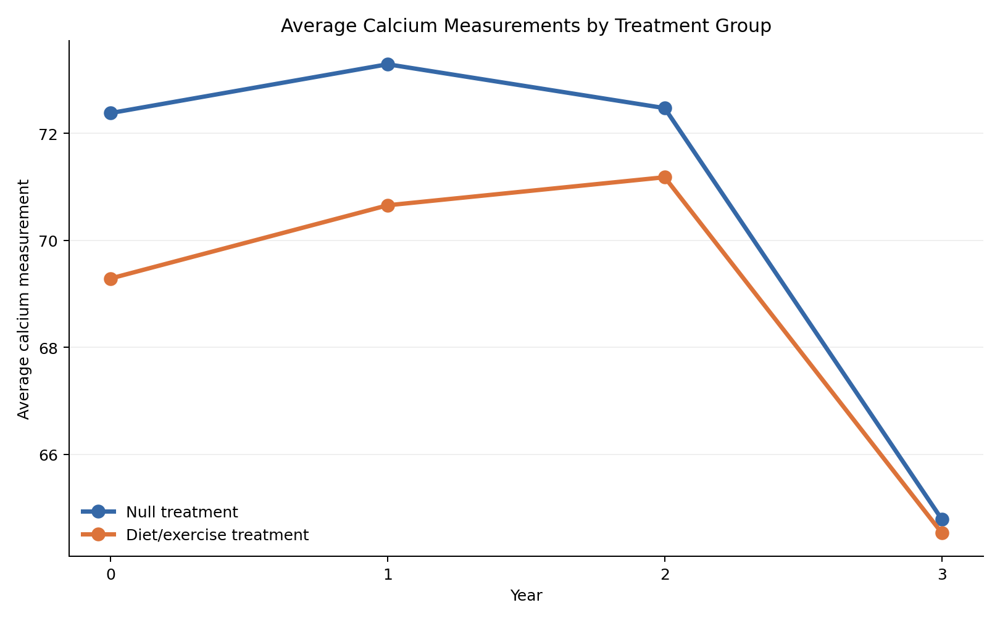

```{r}
#| label: setup
# Load packages and data ----
library(tidyverse)
library(knitr)
library(kableExtra)
library(ggimage) # Draws team logos as plot points

data(diamonds)
```

# Diamonds Table of Statistics

@tbl-length, @tbl-width, and @tbl-depth summarize the length, width, and depth (in millimeters) of the 53,920 diamonds in the data set by cut quality, after removing 20 diamonds recorded with a dimension of zero. I expected better-cut diamonds to also be larger, but the tables show the opposite: Fair diamonds have the largest medians (6.18 mm long, 6.10 mm wide, 3.97 mm deep) and Ideal diamonds the smallest (5.25 mm, 5.26 mm, and 3.23 mm), even though Ideal is by far the most common cut. My guess is that cut quality and size involve some kind of trade-off, where getting a better cut might mean ending up with a smaller stone, though these tables alone cannot confirm that. A few maximums also look suspicious, such as a Premium diamond listed as 58.90 mm wide when the 80% quintile is under 7 mm, so these are probably recording mistakes, and the median is a safer summary than the maximum here.

```{r}
#| label: diamonds-wrangling
# Remove impossible diamonds, keep needed columns ----
newDiamonds <- diamonds |>
  filter_out(x == 0 | y == 0 | z == 0) |>
  select(cut, x, y, z)

# Stack x, y, z into one column ----
longDiamonds <- newDiamonds |>
  pivot_longer(
    cols = c(x, y, z),
    names_to = "dimension",
    values_to = "measurement"
  )

# Group by cut and dimension, then summarize ----
diamondStats <- longDiamonds |>
  group_by(cut, dimension) |>
  summarize(
    Count = n(),
    Min = min(measurement),
    Quintile1 = quantile(measurement, probs = 0.2),
    Quintile2 = quantile(measurement, probs = 0.4),
    Median = median(measurement),
    Quintile3 = quantile(measurement, probs = 0.6),
    Quintile4 = quantile(measurement, probs = 0.8),
    Max = max(measurement),
    Mean = mean(measurement),
    SD = sd(measurement),
    .groups = "drop"
  )

# Column headings shared by all three tables ----
statNames <- c(
  "Cut", "Count", "Min (0%)", "20%", "40%", "Median",
  "60%", "80%", "Max (100%)", "Mean", "SD"
)

# Function to build the table for one dimension ----
# statsData: the summarized statistics (diamondStats)
# dimLetter: which dimension to keep, "x", "y", or "z"
# colNames: the column headings for the table
makeDimTable <- function(statsData, dimLetter, colNames) {
  statsData |>
    filter(dimension == dimLetter) |>
    select(-dimension) |>
    kable(col.names = colNames, digits = 2) |>
    kable_classic(full_width = FALSE)
}
```

```{r}
#| label: tbl-length
#| tbl-cap: "Length (mm) of Diamonds by Cut Quality"
# Table of length (x) statistics ----
makeDimTable(diamondStats, "x", statNames)
```

```{r}
#| label: tbl-width
#| tbl-cap: "Width (mm) of Diamonds by Cut Quality"
# Table of width (y) statistics ----
makeDimTable(diamondStats, "y", statNames)
```

```{r}
#| label: tbl-depth
#| tbl-cap: "Depth (mm) of Diamonds by Cut Quality"
# Table of depth (z) statistics ----
makeDimTable(diamondStats, "z", statNames)
```

# Big 10 Academic Alliance: Love Data Week
@fig-btaa compares three point attempts per game with points per game for the 18 Big Ten women's basketball teams in the 2025-2026 season, with each team shown by it's logo. Teams that shoot more 3's tend to score a little more but the relationship is weak. Ohio State is high on both, while UCLA scores among the most with only averaging 19.4 3pt attempts per game. USC and Wisconsin shoot the most 3's without scoring above average. Penn State sits almost exactly at the Big Ten average on both measures. This shows a slight association NOT causation: with only 18 teams, one season, and the observed data, there are confounding variables such as how efficient the teams were on those 3pt attempts and other offensive statistics.

```{r}
#| label: btaa-wrangling
# Load the team box scores ----
wbbTeams <- read_csv("BigTenDataHW4.3/team_box.csv")

# Name the 18 Big Ten teams ----
# The data has no conference column, so teams are listed by name
bigTen <- c(
  "Illinois", "Indiana", "Iowa", "Maryland", "Michigan",
  "Michigan State", "Minnesota", "Nebraska", "Northwestern",
  "Ohio State", "Oregon", "Penn State", "Purdue", "Rutgers",
  "UCLA", "USC", "Washington", "Wisconsin"
)

# One row per Big Ten team with its 2025-26 per-game averages ----
teamSummary <- wbbTeams |>
  filter(season == 2026) |>                 # Keep only the 2025-26 season
  filter(team_location %in% bigTen) |>      # Keep only Big Ten teams
  group_by(team_location, team_logo) |>     # One row per team, keep its logo link
  summarize(
    games = n(),                                       # Games played
    avg3PA = mean(three_point_field_goals_attempted),  # 3-point attempts per game
    avgPPG = mean(team_score),                         # Points per game
    .groups = "drop"
  )
```

```{r}
#| label: fig-btaa
#| fig-cap: "Do Big Ten Teams That Shoot More Three-Pointers Score More Points? (2025-26 Season)"
#| fig-alt: "Scatterplot of 18 Big Ten women's basketball team logos showing three-point attempts per game against points per game, with dashed average lines."
#| fig-height: 4
#| fig-pos: "H"
# Scatterplot of 3-point attempts vs. points per game ----
teamSummary |>
  ggplot(
    mapping = aes(
      x = avg3PA,
      y = avgPPG
    )
  ) +
  geom_image(aes(image = team_logo), size = 0.07) +  # Each team's logo as its point
  geom_vline(
    xintercept = mean(teamSummary$avg3PA),          # Big Ten average 3PA
    linetype = "dashed"
  ) +
  geom_hline(
    yintercept = mean(teamSummary$avgPPG),          # Big Ten average PPG
    linetype = "dashed"
  ) +
  scale_x_continuous(breaks = seq(16, 25, by = 1)) +
  scale_y_continuous(breaks = seq(55, 85, by = 3)) +
  coord_cartesian(xlim = c(16, 25)) +               # Zoom in on the Big Ten range
  labs(
    x = "Three-Point Attempts per Game",
    y = "Points per Game",
    subtitle = "Dashed lines = Big Ten averages",
    caption = "Source: ESPN women's college basketball team box scores, 2025-26 season"
  ) +
  theme_bw()
```

# Monte Carlo Numerical Integration

I think the exact answer to the numerical integration of the Weibull denisty curve is about 1 or maybe slightly less but very close to 1 as demonstrated in @fig-monte-carlo, because this is a density curve and the area under a density curve equals one. My small mutiple supports this because the estimates get closer to the number 1 as the number of points grows. 0.64 with 10 points, 1.088 with 100, 0.982 with 1,000 and 0.997 with 10,000 points. With only 10 points the estimate is far off, but with 10,000 points the teal points fill in the exact shape of the curve, so someone looking at the four panels would see the estimate settle just under 1.

```{r}
#| label: fig-monte-carlo
#| fig-cap: "Monte Carlo estimates of the area under the Weibull density (shape = 1.5, scale = 1) from x = 0 to 4, using 10, 100, 1,000, and 10,000 random points."
#| fig-height: 5
#| fig-width: 6
# Monte Carlo Numerical Integration: Weibull ----
# Coder: Colin Thurow
# Goal: Estimate the area under the Weibull function
# (shape = 1.5, scale = 1) between x = 0 and x = 4 with a Monte Carlo
# simulation. We plot random points in a box around the curve, find
# the proportion that land under the curve, and multiply by the box's
# area. We repeat with 4 different sample sizes (10, 100, 1,000, and 10,000
# random points) and combine the plots into a small multiple to see how
# the estimate improves.
monte_carlo_points <- function(nPoints, xMin, xMax, yMin, yMax) {
  data.frame(
    x = runif(n = nPoints, min = xMin, max = xMax),
    y = runif(n = nPoints, min = yMin, max = yMax)
  )
}

# Step 1: Load packages ----
library(tidyverse)
library(patchwork)

# Step 2: Simulation function ----
# Makes nPoints random points inside the box set by the x and y bounds.
# Returns a data frame with one row per point.
monte_carlo_points <- function(nPoints, xMin, xMax, yMin, yMax) {
  data.frame(
  x = runif(n = nPoints, min = xMin, max = xMax),
  y = runif(n = nPoints, min = yMin, max = yMax)
  )
}

# Step 3: Set the bounds of the box (edit these for a new situation) ----
xMin <- 0
xMax <- 4
yMin <- 0
yMax <- 0.8   # the curve peaks at about 0.75, so 0.8 covers it
boxArea <- (xMax - xMin) * (yMax - yMin)

# Step 4: Wrangling function ----
# Runs the simulation and marks whether each point is under the curve.
make_mc_data <- function(nPoints) {
  monte_carlo_points(nPoints = nPoints,
  xMin = xMin, xMax = xMax,
  yMin = yMin, yMax = yMax) |>
    mutate(underCurve = y <= dweibull(x, shape = 1.5, scale = 1))
}

# Step 5: Plot function ----
# Estimates the area (share of points under the curve x box area),
# then plots the points and the curve with the estimate in the subtitle.
make_mc_plot <- function(nPoints) {
  mcData <- make_mc_data(nPoints = nPoints)
  estArea <- mean(mcData$underCurve) * boxArea

  mcData |>
  ggplot(mapping = aes(x = x, y = y, color = underCurve)) +
  geom_point(size = 0.7) +
  stat_function(fun = dweibull,
  args = list(shape = 1.5, scale = 1),
  xlim = c(xMin, xMax),
  color = "black") +
  labs(title = paste0(nPoints, " random points"),
  subtitle = paste0("Estimated area: ", round(estArea, 3)),
  x = "x",
  y = "Density",
  color = "Under curve?") +
  theme_bw()
}

# Step 6: Make one plot for each sample size ----
plot10 <- make_mc_plot(nPoints = 10)
plot100 <- make_mc_plot(nPoints = 100)
plot1000 <- make_mc_plot(nPoints = 1000)
plot10000 <- make_mc_plot(nPoints = 10000)

# Step 7: Combine the four plots into a small multiple ----
plot10 + plot100 + plot1000 + plot10000
```

# Planning and Prompting GenAI Tools

## My Plan
### A. **Goals**
1. Tidy the calcium data so each row represents one woman's calcium measurement at a specific year.
2. Create a graph to compare calcium levels over time between the two treatment groups.

### B. **Needs**
**Nouns:** Calcium dataset, data frame, women, treatment groups, woman ID, years, calcium measurements, averages, line graph.

**Verbs:** Read, separate, label, combine, pivot, group, calculate, graph, compare.

### C. **Steps**
1. Use read.csv to import the calcium data into R.
2. Separate the first four columns (null treatment) from the last four columns (diet/exercise treatment).
3. Assign each woman a unique ID and label their treatment group.
4. Combine the two treatment groups into one data frame.
5. Use pivot_longer to create separate columns for year and calcium measurement.
6. Check that the tidy data contains 31 women with four measurements each.
7. Group the data by treatment group and year, then calculate the average calcium measurement for each.
8. Create a line graph with year on the x-axis, average calcium on the y-axis, and different colors for each treatment group.
9. Compare the trends in calcium measurements between the two groups over time.

## Plan Informed Response
I gave ChatGPT my plan above along with the unaltered calcium.csv file. Its graph is shown in @fig-plan-informed, and its full text response is quoted below.

{#fig-plan-informed fig-alt="ChatGPT line graph of average ulnar calcium for the null and diet/exercise groups from year 0 to year 3, with both groups dropping in year 3." width=80%}

"Calcium Data Analysis

A. Goals
1. Tidy the calcium data so each row represents one woman's calcium measurement at a specific year.
2. Create a graph to compare calcium levels over time between the two treatment groups.
B. Results

The dataset contained 31 women, with 15 in the null-treatment group and 16 in the diet/exercise group. Each woman had four calcium measurements, resulting in 124 total observations.

I organized the data into a tidy format with separate columns for woman ID, treatment group, year, and calcium measurement.

I then calculated the average calcium measurement for each treatment group at each year.

Year 0:
Null treatment: 72.38
Diet/exercise: 69.29

Year 1:
Null treatment: 73.29
Diet/exercise: 70.66

Year 2:
Null treatment: 72.47
Diet/exercise: 71.18

Year 3:
Null treatment: 64.79
Diet/exercise: 64.53

C. Graph

I created a line graph with year on the x-axis and average calcium measurement on the y-axis. Each treatment group was represented by a different colored line to show how calcium measurements changed over time.

D. Conclusion

The null-treatment group started with a higher average calcium measurement than the diet/exercise group. Both groups showed some increases and decreases during the first three measurements before experiencing a noticeable decrease in year 3.

From year 0 to year 3, the null-treatment group's average calcium decreased by 10.5%, while the diet/exercise group's average decreased by 6.9%.

Overall, the diet/exercise group experienced a smaller decrease in average calcium measurements. However, both groups ended with very similar averages. This suggests that the diet/exercise group may have maintained calcium levels slightly better, but the results alone do not prove that the treatment caused this difference."

## Generic Response

The assignment provided the response below, which came from giving ChatGPT a generic prompt along with the same calcium.csv file. Its graph is shown in @fig-generic, followed by the full text of the exchange.

{#fig-generic fig-alt="ChatGPT plot showing the average of each of the eight calcium columns as a single point, with values from about 65 to 73 and no treatment groups shown." width=80%}

**Prompt:** "Create a data visualization for these data. Calcium.csv"

I created a visualization showing the average value of each column in your dataset.

What this shows:

Each point represents the mean (average) of one column (y0, y1, y2, y3, etc.).
You can quickly compare which variables tend to have higher or lower values overall.
For example, some columns cluster around ~70–73, while others drop closer to ~65.

If you want something more insightful, I can also create:

Boxplots (to show spread and outliers)
Time series plots (if rows represent time/order)
Correlation heatmaps
Side-by-side comparisons (e.g., y0 vs y0.1)

Just tell me [thumbs-up emoji]

**Prompt:** "What is your version information?"

You're chatting with ChatGPT based on the GPT-5.3 architecture.

Key details:

Model: GPT-5.3
Knowledge cutoff: August 2025
Current date (system): March 31, 2026

If you need more technical details (capabilities, differences vs GPT-4/5, etc.), just let me know [thumbs-up emoji]

(This chat took place on Tuesday, March 31st, 2026.)


## Comparison

@fig-plan-informed and @fig-generic were both made by ChatGPT from the same calcium.csv file, but they tell very different stories. The plan-informed response understood that each case is one woman measured four times and that the situation is an experiment comparing two treatment groups over three years. It split the null group (15 women) from the diet/exercise group (16 women), ignored the empty row instead of counting it as a 16th woman in the null group, and plotted one line per group across years 0 to 3. The generic response treated the file as eight unrelated columns and plotted the mean of each one, so it never shows the two treatment groups or any change over time. Its offer to compare “y0 vs y0.1” shows it did not realize the repeated column names belonged to different groups, and it guessed that rows might represent time when the years are actually in the columns. The generic plot is not wrong, but it does not answer the question the data were collected to answer. Writing a plan forced me to explain the cases, groups, and goal, and that was the context ChatGPT needed to produce a better graph.

# Reflection

Before Stat 184, I had never coded. Since then I've learned what R is and how to use it to tidy and wrangle data, and then present the results in tables and graphs. The assignments where I felt I learned the most were the diamonds, Galton family, and armed forces datasets. Starting with the raw data, seeing how messy it looked, tidying it, and then presenting it in a clean table helped me understand how the whole data process works from beginning to end.

I also learned that the same data can be shown in many different ways, like scatter plots or bar graphs, depending on what you want to show. My favorite assignment was the Big Ten data visualization homework because we got to be creative and work with basketball statistics which is something I'm passionate about. I made a scatter plot and used functions like kable_classic to format my output so it was clear and easy to read.

One of the biggest lessons I'm taking from this class is to make a plan before I start coding. Writing out my goals, what I need, and the steps I'll take keeps me organized and makes my work easier to keep up over time. Documentation matters just as much. Leaving comments and keeping my code organized means I can come back to it later and still understand what I did. I also learned how to use Quarto to present and format my work in different ways, including adding appendices that keep a log of my code.

I still have things to improve. I sometimes get frustrated when my code doesn't work, so I want to get better at working through errors patiently and solving problems on my own. I also want to spend more time learning other tidyverse functions and how they're used. My goal is to write code that is DRY and as efficient as possible.



# GenAI Usage Appendix

Model: ChatGPT GPT-6

date used 11/19/26

**Prompt:**
"Here is the csv file, and my plan. Carry out my plan" attached the csv file and my plan as shown in section 4.1

**Exact Response:**


"Calcium Data Analysis

A. Goals
1. Tidy the calcium data so each row represents one woman's calcium measurement at a specific year.
2. Create a graph to compare calcium levels over time between the two treatment groups.
B. Results

The dataset contained 31 women, with 15 in the null-treatment group and 16 in the diet/exercise group. Each woman had four calcium measurements, resulting in 124 total observations.

I organized the data into a tidy format with separate columns for woman ID, treatment group, year, and calcium measurement.

I then calculated the average calcium measurement for each treatment group at each year.

Year 0:
Null treatment: 72.38
Diet/exercise: 69.29

Year 1:
Null treatment: 73.29
Diet/exercise: 70.66

Year 2:
Null treatment: 72.47
Diet/exercise: 71.18

Year 3:
Null treatment: 64.79
Diet/exercise: 64.53

C. Graph

I created a line graph with year on the x-axis and average calcium measurement on the y-axis. Each treatment group was represented by a different colored line to show how calcium measurements changed over time.

D. Conclusion

The null-treatment group started with a higher average calcium measurement than the diet/exercise group. Both groups showed some increases and decreases during the first three measurements before experiencing a noticeable decrease in year 3.

From year 0 to year 3, the null-treatment group's average calcium decreased by 10.5%, while the diet/exercise group's average decreased by 6.9%.

Overall, the diet/exercise group experienced a smaller decrease in average calcium measurements. However, both groups ended with very similar averages. This suggests that the diet/exercise group may have maintained calcium levels slightly better, but the results alone do not prove that the treatment caused this difference."



# Code Appendix

```{r codeAppend, ref.label=knitr::all_labels(), echo=TRUE, eval=FALSE}
```