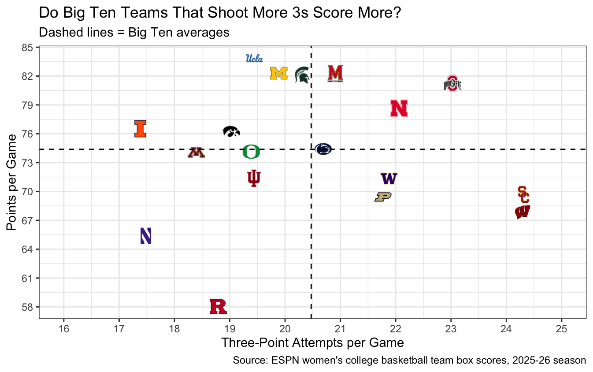

# Stat 184 HW 4.3: Reproducible Data Analysis 

This repo holds my HW 4.3 report for Stat 184 at Penn State: A Quarto document that analyzes four data sets and renders to a PDF. It is also my HW 4.4 practice with Git and GitHub (branches, issues, commits, pull requests)

## Overview
HW 4.3 brings together work from earlier in the semester into one reproducible report. The report has five parts:
1. Diamond Table of Statistics: three tables summarizing the length, width, and depth of diamonds by cut quality.
2. Big Ten Academic Alliance (BTAA) Love Data Week: a scatterplot of Big Ten women's basketball teams comparing three-point attempts and scoring.
3. Monte Carlo Numerical Integration: a small-multiple visualization of a Monte Carlo estimate.
4. Planning and Prompting GenAI Tools: a plan for a new data set (calcium), a plan-informed genAI response, a generic-prompt response, and a comparison of the two.
5. Reflection: what I learned in the course.

### Interesting Insight (Optional)

Shooting more three-pointers did not mean scoring more in the Big Ten this season. UCLA scored the most points per game (about 83) while taking fewer threes than the conference average, 
and USC and Wisconsin took the most threes (over 24 per game) but scored below average. 
Ohio State and Nebraska were the exceptions that shot a lot of threes and still scored well, 
which suggests that making threes matters more than just taking them.

## Data Sources and Acknowledgements
1. Diamonds: the diamonds data set from the {ggplot2} R package.
2. Women's basketball: ESPN women's college basketball team box scores (2025-26 season), collected by the SportsDataverse wehoop project and provided through the BTAA Love Data Week activity.
3. Monte Carlo: simulated data generated in R; no outside data.
4. Calcium: calcium.csv, provided by the course for the Planning and Prompting section.
5. Course materials and templates from Stat 184 (Fall 2026, Penn State). GenAI help is listed in the report's GenAI Usage Appendix.

## Current Plan
1. Create this repo from the course template, clone it with GitHub Desktop, and open the R project.
2. Open issues for each task and do all work on my dev-colin branch.
3. Add the HW 4.3 QMD, its data and images, and the submitted PDF, committing and pushing after each piece.
4. Finish this README.
5. Merge dev-colin into main with a pull request that closes the issues.

## Repo Structure
README.md - This file
plan.md - Plan for building the repo and completing HW 4.3
Homework4.3.qmd - Quarto source for the HW 4.3 report
Homework4.3.pdf - Rendered report, as submitted for HW 4.3
BigTenDataHW4.3/ - Women's basketball team box score data read by the QMD
calcium.csv - Data for the Planning and Prompting section
images/ - Plot images used in the report and this README
HW4.4_Template.Rproj - R project file; open this to work in RStudio
optional_files/ - Extra files from the course template

## Authors

Colin Thurow, Penn State, Stat 184 (Fall 2026). Contact: thurowcolin8@gmail.com
